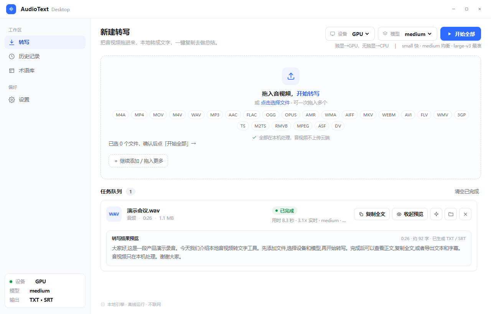
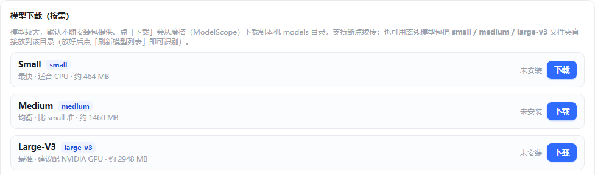

# AudioText Desktop · 音视频转文字

把音视频在本机转成可复制的文字稿。支持 Windows 10/11 x64、NVIDIA GPU / CPU、批量队列、术语校正，以及 TXT / SRT 导出。

[下载 v0.5.0](https://github.com/Astyyym/audiotext-desktop/releases/tag/v0.5.0) · [安装说明](INSTALL.md) · [更新记录](CHANGELOG.md)

## 界面预览

Windows Electron 桌面主界面：文件先进入待确认区，点击「开始全部」后转写，完成后可展开预览、复制全文和打开输出目录。截图由当前源码运行的桌面程序生成，使用独立配置与生成的演示录音。

模型页提供 Small、Medium、Large-v3 的下载状态和操作；仅用户主动点击时联网，默认来源为魔搭 ModelScope。

## 下载与安装

从 [v0.5.0 Release](https://github.com/Astyyym/audiotext-desktop/releases/tag/v0.5.0) 下载本体安装器：

| 文件 | 用途 |
|---|---|
| [AudioTextDesktop-Setup-0.5.0.exe](https://github.com/Astyyym/audiotext-desktop/releases/download/v0.5.0/AudioTextDesktop-Setup-0.5.0.exe) | Windows x64 **基础安装器**：引擎 + ffmpeg，**默认 CPU，不含 CUDA、不含模型** |
| [SHA256](https://github.com/Astyyym/audiotext-desktop/releases/download/v0.5.0/AudioTextDesktop-Setup-0.5.0.exe.sha256) | 校验下载文件 |

运行基础安装器，按向导选择自己的安装目录。当前版本未签名，Windows 可能提示未知发布者。准备至少一个模型后即可用 CPU 转写，无需安装 Python 或 CUDA Toolkit。

**体积较大的 GPU 加速包与模型不随 GitHub Release 上传，通过外部链接获取：**

- **GPU 加速包（CUDA 12，约 412MB）**：[AudioTextDesktop-GPU-cu12-gpu-cu12-v1.7z](https://github.com/Astyyym/audiotext-desktop/releases/download/gpu-cu12-v1/AudioTextDesktop-GPU-cu12-gpu-cu12-v1.7z)。也可在应用「设置 → 硬件加速」内直接下载或导入。不装 GPU 包也能正常 CPU 转写。
- **模型**：在应用「设置 → 模型下载（按需）」从 [魔搭 ModelScope](https://modelscope.cn/models/Systran/faster-whisper-large-v3) 按需获取，或导入离线模型包（见下方「准备模型」）。

## 准备模型

- **推荐方式**：打开「设置 → 模型下载（按需）」，选择 Small / Medium / Large-v3 并点击下载。支持进度显示、取消和断点续传。
- **已有本地模型**：点击「打开模型目录」，将完整的 CTranslate2 模型文件夹放到安装目录的 `resources/models/<模型名>/`，再点击「刷新模型列表」。
- **选型**：Small 更快、适合 CPU；Medium 均衡；Large-v3 适合有足够显存、追求准确率的 NVIDIA GPU 机器。

自动模型仅在已安装的模型中选择：有 GPU 时依次优先 Medium → Large-v3 → Small；无 GPU 时依次优先 Small → Medium → Large-v3。详见 [安装说明](INSTALL.md)。

## 使用

1. 拖入或选择音视频，检查待确认文件列表。
2. 在顶栏选择设备与模型，点击「开始全部」。
3. 完成后复制全文、展开预览，或打开输出目录获取 TXT / SRT。重复转写、同名输入会为新输出加序号，保留旧稿。
4. 需要总结时，把文字稿和设置页可编辑的 AI 提示词复制到自己选择的网页 AI。

设置、历史与术语在本地持久化；支持自定义历史存储位置。桌面默认输出 TXT + SRT，MD / JSON 可通过引擎 CLI 导出。应用本身不调用在线 AI。

## 隐私与当前范围

转写使用本地模型，不上传音视频。只有用户主动下载模型时联网；模型准备好后可断网转写。示例和截图使用虚构内容，不包含真实录音。

当前版本面向 Windows 10/11 x64；代码签名、自动更新、多机型全面验收尚未完成。长音频、显存不足和不同驱动的表现会受硬件影响。

## 模型来源与许可

使用 faster-whisper 的 CTranslate2 模型，模型不进入 Git 仓库：

- [Small · ModelScope](https://modelscope.cn/models/Systran/faster-whisper-small)
- [Medium · ModelScope](https://modelscope.cn/models/Systran/faster-whisper-medium)
- [Large-v3 · ModelScope](https://modelscope.cn/models/Systran/faster-whisper-large-v3)

项目代码使用 [MIT 许可](LICENSE)。模型由 OpenAI Whisper 转换而来；faster-whisper / CTranslate2 / ffmpeg 等遵循各自许可，ffmpeg 分发使用 LGPL 构建。

## 开发与构建

- [Electron 前端](app/README.md) / [转写引擎](engine/README.md)
- [构建引擎](scripts/build-engine.ps1) → [准备 ffmpeg](scripts/fetch-ffmpeg.ps1) → [构建安装器](scripts/build-app.ps1)
- [模型离线包工具](scripts/package-models.py) 可用于自行整理本地 ZIP64 包，不作为本 Release 附件。
- 下载与恢复测试：`node --test scripts/tests/model-download.test.cjs`
- 引擎发布回归：`python -m unittest discover -s scripts/tests -p test_engine_release.py`

## 项目文档

| 文档 | 内容 |
|---|---|
| [PRD](docs/PRD.md) | 产品范围、需求与验收目标 |
| [技术设计](docs/design.md) | 架构、模型策略、输出格式与分发 |
| [协作规则](AGENTS.md) | 长期约束与工作纪律 |
| [项目记忆](memory/README.md) | 稳定环境与已知问题 |
